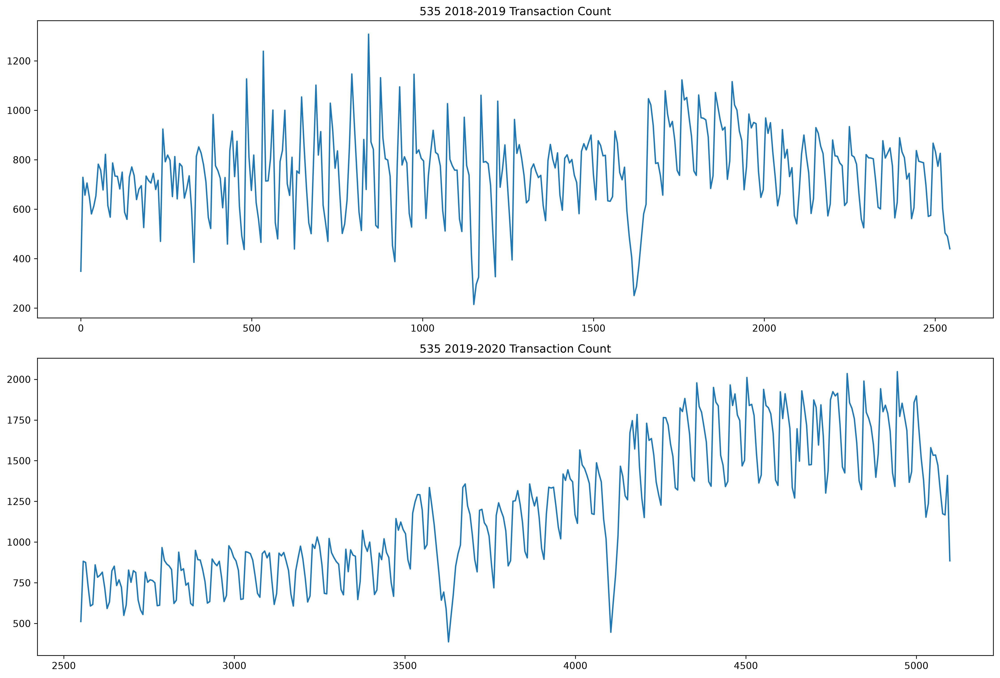
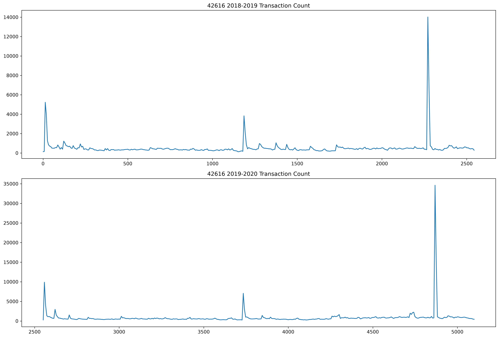
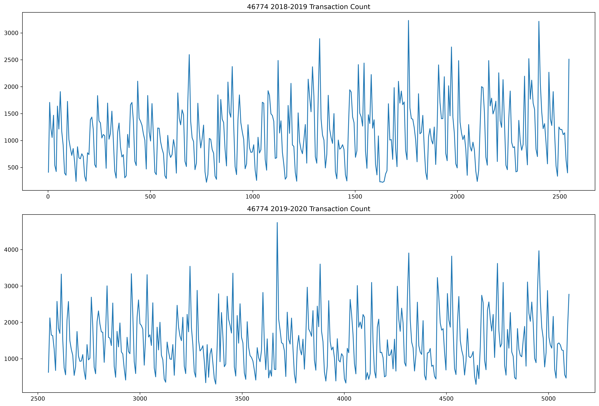
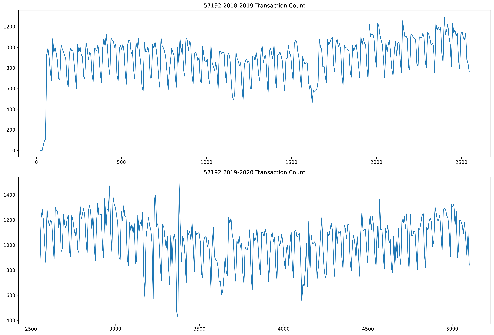
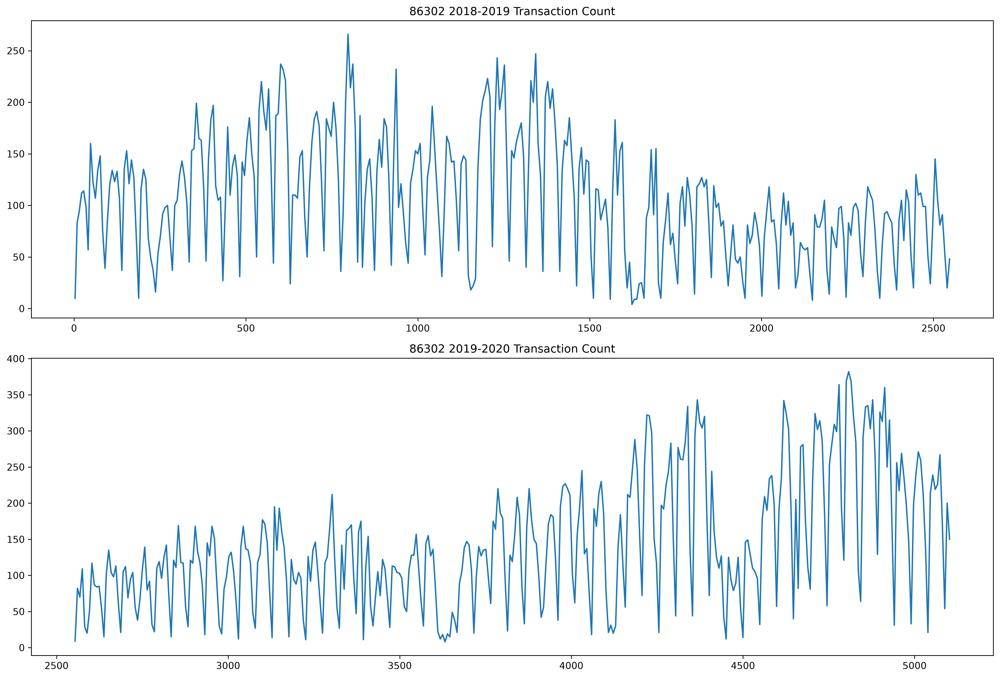
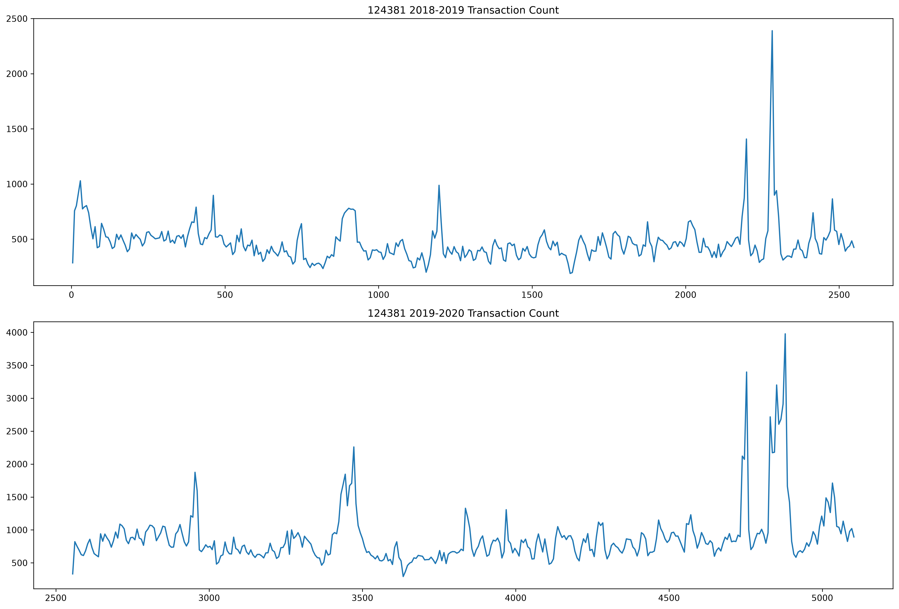
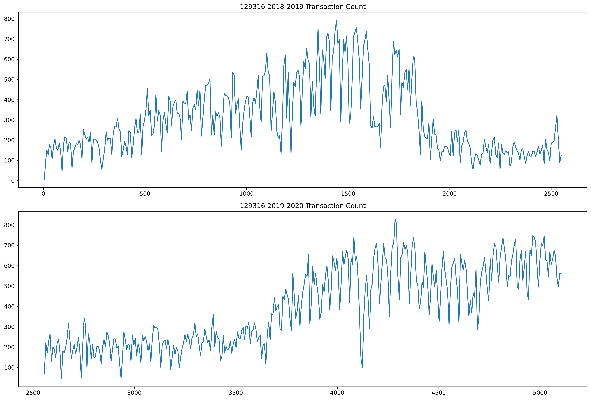
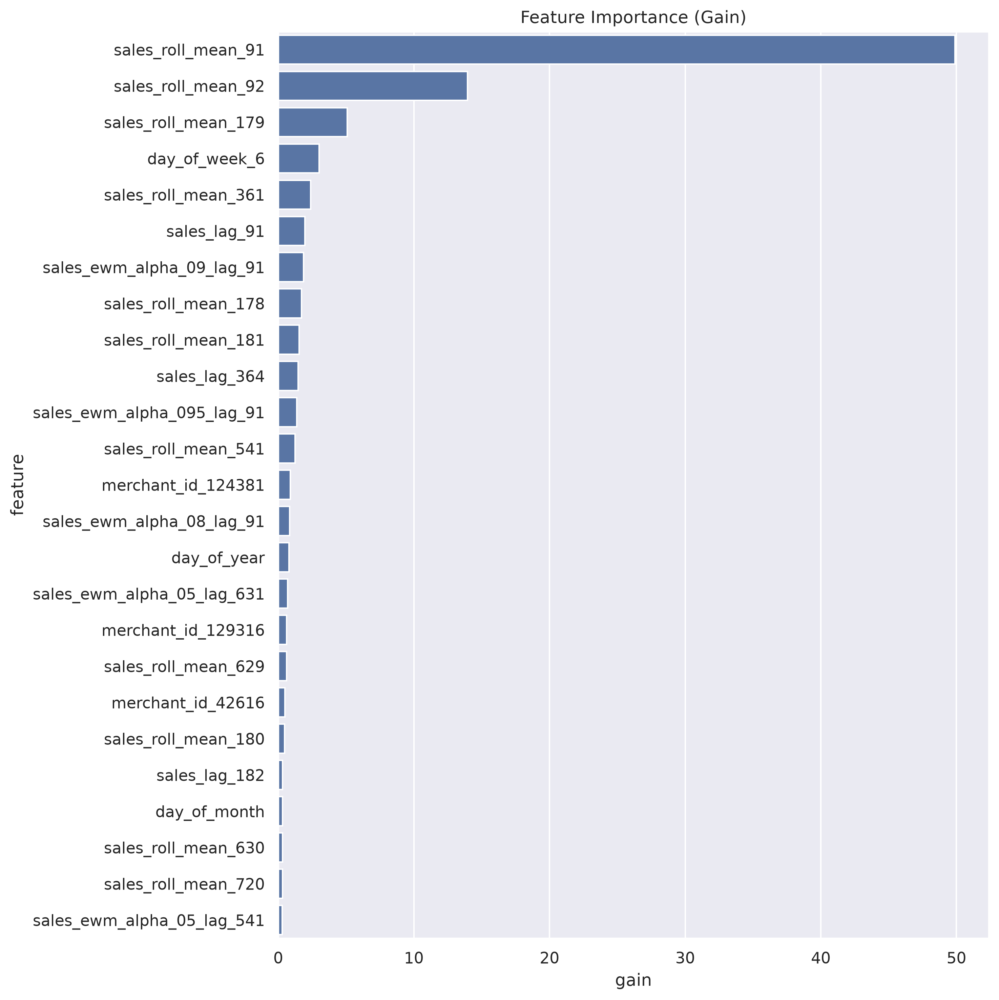
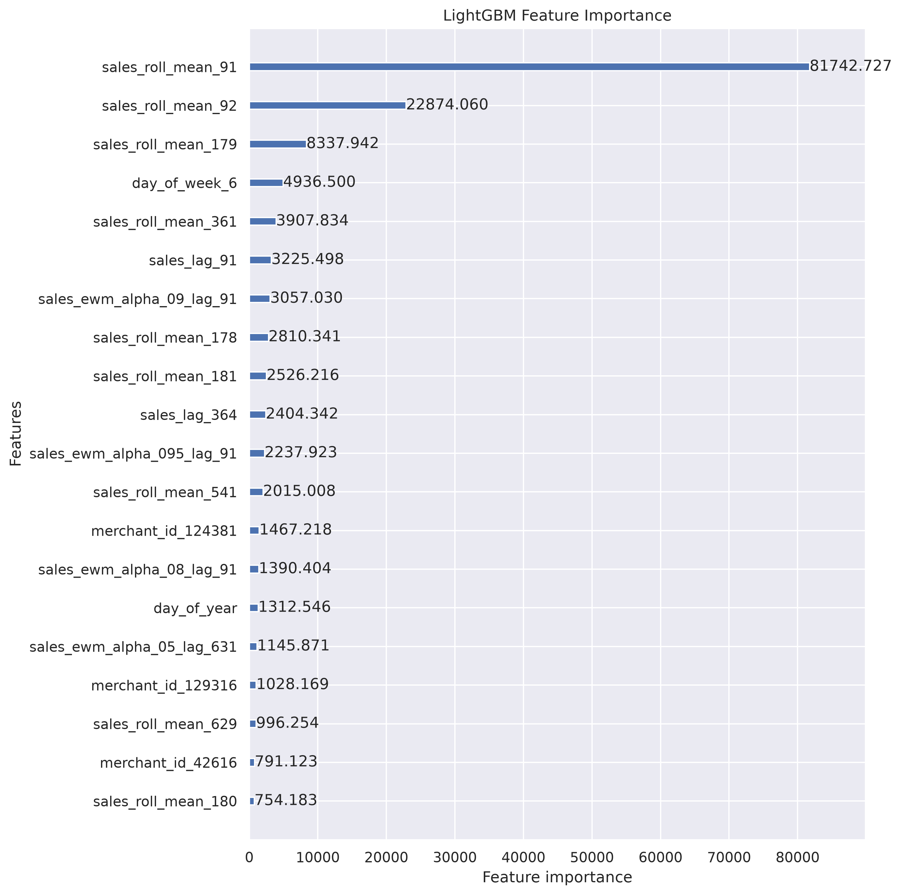

# 💳 Iyzico Transaction Count Forecasting

This project is an end-to-end time series forecasting and machine learning project. It predicts the daily total transaction count of merchants for the last 3 months of 2020 using Iyzico historical data.

---

##  🔗 Project Overview & Business Problem
* **Business Problem:** iyzico provides payment infrastructure for e-commerce companies, marketplaces, and individual users. The goal of this project is to accurately forecast the daily total transaction count (`Total_Transaction`) for each merchant (`merchant_id`) for the last 3 months of 2020.
* **Model Performance:** Achieved a successful validation error rate of **20.89% SMAPE** using a LightGBM model equipped with **Early Stopping** and optimized at the 313th iteration.

---

### 🔗 Database Management

In this project, data is retrieved directly from a local **PostgreSQL** database to ensure data integrity and reliability.

1. **Database Storage:**
   The raw transaction data is stored in the `iyzico_transactions` table within the `iyzico_db` database.

2. **Data Extraction (Export):**
   Prior to modeling and analysis, the data is fetched directly from the database and exported into the working CSV file named `iyzico_data_from_db.csv` using the `export_from_db.py` script.

   You can extract and prepare the dataset using the following command:
   ```bash
   python export_from_db.py

## 🔗 Dataset Story & Features
The dataset contains historical transaction records from 2018 to 2021 for 7 different merchants across multiple categories.

* **Total Size:** 7,667 observations and 5 primary variables.
* **Variables Description:**
  * `transaction_date`: The date of the sales/transaction records.
  * `merchant_id`: Unique identification number for each merchant.
  * `Category`: The business category of the merchant.
  * `Total_Transaction`: The total count of transactions made on that specific day.
  * `Total_Paid`: The total payment amount (price) processed.

---
### 🔗 Exploratory Data Analysis (EDA) - Merchant Transaction Counts

Time-series transaction count graphs for each merchant across years:

- **Merchant 535:** 
- **Merchant 42816:** 
- **Merchant 46774:** 
- **Merchant 57192:** 
- **Merchant 86302:** 
- **Merchant 124381:** 
- **Merchant 129316:** 

### 🔍 Feature Importance & Model Results

Feature importance levels generated by the LightGBM model:

- **Feature Importance Barplot:** 
- **Native Importance Plot:** 


## 🔗 Feature Engineering Methodology
To help the machine learning model capture trends, seasonality, and complex patterns, a wide range of features were engineered:
* **Date Features:** Extracted month, day, day of year, week of year, day of week, year, weekend indicator (`is_wknd`), month start/end, quarter, and year start/end indicators. Special calendar events like **Black Friday** and **Summer Solstice** were also incorporated.
* **Lag / Shifted Features:** Created historical lagged features ranging from 91 days up to 722 days to capture annual and periodic patterns.
* **Rolling Mean Features:** Computed rolling window averages to smooth out short-term fluctuations and capture underlying trends.
* **Exponentially Weighted Mean (EWM) Features:** Generated exponentially weighted moving averages using various alpha values and lag combinations.

---

## 🔗 Tech Stack & Prerequisites
* **Python 3.11.17**
* **Libraries:**
  * `pandas` (v3.0.6)
  * `numpy` (v2.4.6)
  * `lightgbm` (v4.7.0)
  * `matplotlib` (v3.11.2)
  * `seaborn` (v0.13.2)
  * `scipy` (v1.17.1)

---

## 🚀 Installation & Setup
1. Clone the repository:
   ```bash
   git clone [https://github.com/dudukbb/iyzico-transaction-forecasting.git](https://github.com/dudukbb/iyzico-transaction-forecasting.git)
   cd iyzico-transaction-forecasting
